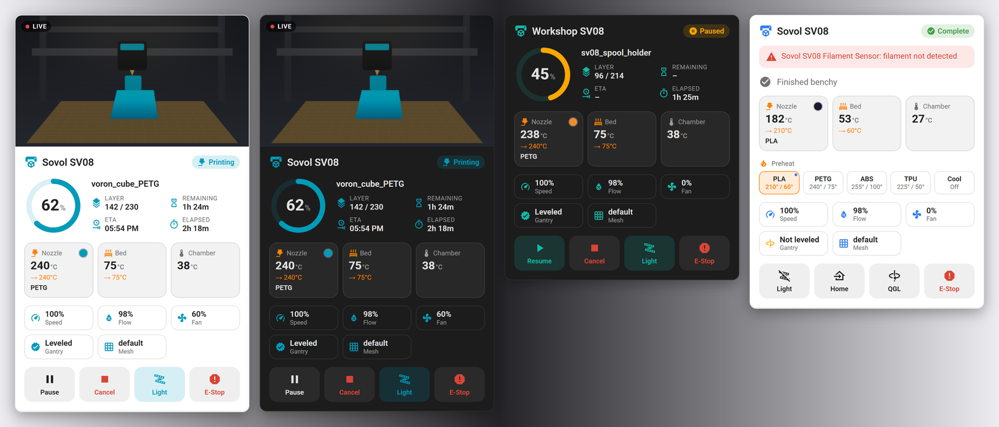
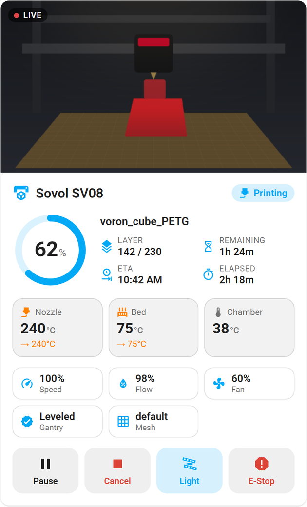
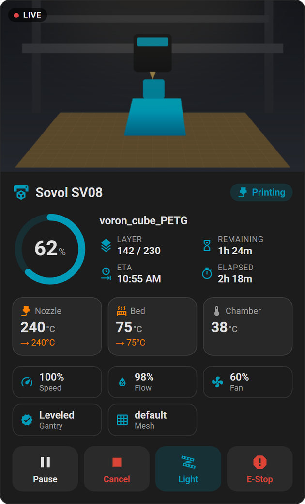
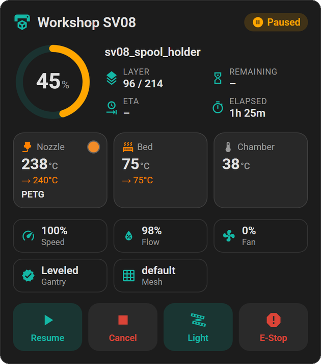
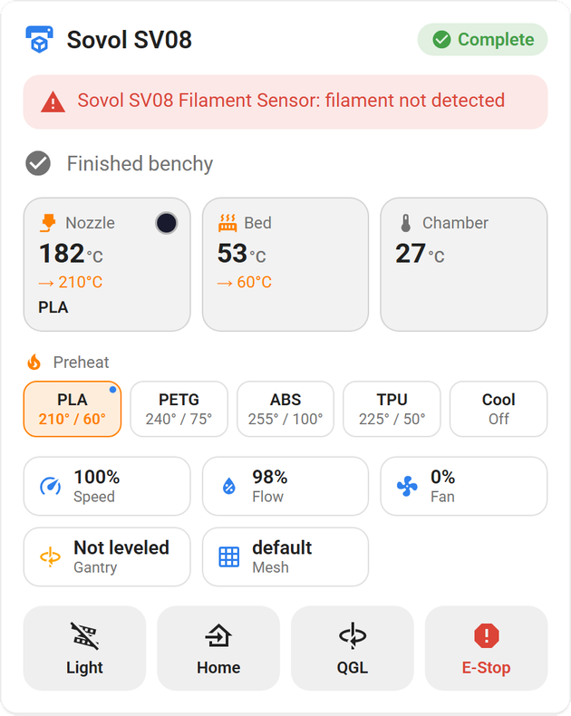

# ha-sovol-sv08

> A Home Assistant custom integration for the **Sovol SV08** 3D printer.
> Live status, temperatures, camera, print controls, quad gantry leveling,
> bed mesh, preheat presets and a built-in dashboard card. No cloud needed.



<sub>Mockups of the bundled dashboard card rendered with sample data. Your card
shows your printer's real camera and values.</sub>

Sister project of [ha-snapmaker-u1](https://github.com/kbaker827/ha-snapmaker-u1),
rebuilt for the SV08's stock Klipper setup.

## Contents

- [How it works](#how-it-works)
- [Features](#features)
- [Sovol eddy probe upgrade](#sovol-eddy-probe-upgrade)
- [Dashboard card](#dashboard-card)
- [Installation](#installation)
- [Configuration](#configuration)
- [Authentication](#authentication)
- [Automations](#automations)
- [Troubleshooting](#troubleshooting)
- [Development](#development)
- [Technical notes](#technical-notes)

---

## How it works

The SV08 runs stock **Klipper** with **Moonraker** and **Mainsail**, served by
nginx on port 80. The integration talks straight to Moonraker on your network:

- **WebSocket** (JSON-RPC 2.0) at `ws://<printer-ip>/websocket` for live push
  updates.
- **HTTP** at `http://<printer-ip>/` for commands, and as a fallback poll when
  the WebSocket is down.

No Sovol account, cloud or extra software on the printer is needed. Anything
Mainsail can see, this integration can see.

The integration reads the printer's Klipper object list at startup, so it
adapts to mods. An added chamber thermistor, an exhaust `fan_generic` or a
neopixel strip shows up without any configuration.

---

## Features

### Sensors
| Entity | Description |
|---|---|
| Print state | `standby` / `printing` / `paused` / `complete` / `error` / `cancelled` |
| Print progress | Percentage complete |
| Current layer / Total layers | Current layer needs `SET_PRINT_STATS_INFO` from the slicer (Orca and Prusa/Super Slicer can emit it); total layers falls back to the file's slicer metadata |
| Print duration / Total duration | Printing time (excluding pauses) and time since start |
| Time remaining / Print ETA | Uses the slicer's estimate for the first 10 % of a print, then the file position |
| Filament used | Millimetres of filament extruded |
| Filename | File being printed (slicer and its estimate as attributes) |
| Nozzle / Bed temperature and target | Current and target temperatures; `power` and `max_temp` as attributes |
| Part cooling fan | Fan speed in %. The SV08 has no Klipper `[fan]`; its part cooling is `fan0` + `fan1`, which this reads |
| Print speed / Flow rate | Current `M220` / `M221` overrides in % |
| Bed mesh profile | Name of the loaded mesh, e.g. `default` |
| Probe Z result | Last probe reading in mm (inductive probe or eddy); `triggered` as attribute |
| Every `temperature_sensor` | e.g. MCU and host temperature, a chamber thermistor |
| Every other fan | On a stock SV08: back and front part fans (`fan0`, `fan1`), exhaust fan (`fan3`) and hotend fan. Any `heater_fan`, `controller_fan`, `fan_generic` or `temperature_fan` is picked up |
| Klipper state / Toolhead position | Diagnostics |

### Binary sensors
| Entity | Description |
|---|---|
| Printer ready | On when Klipper reports `ready` |
| Printing / Paused | Print job state |
| Error | On for a print error or a Klipper shutdown (message in attributes) |
| Gantry leveled | On once `QUAD_GANTRY_LEVEL` has been applied since the last restart |
| Eddy probe calibrated | With Sovol's eddy upgrade: on once the eddy probe has been calibrated |
| Filament runout | One per `filament_switch_sensor` / `filament_motion_sensor`; on when filament is **not** detected |

### Buttons
| Button | Action |
|---|---|
| Pause / Resume / Cancel print | Control the active print |
| Emergency stop | Halts the printer at once (`M112`) |
| Home all / Home X / Y / Z | `G28` |
| Quad gantry level | Homes if needed, runs `QUAD_GANTRY_LEVEL`, then re-homes Z |
| Bed mesh calibrate | Homes if needed, levels the gantry if it isn't yet, then `BED_MESH_CALIBRATE` |
| Z offset calibrate | Sovol's `Z_OFFSET_CALIBRATION` (probe-to-nozzle offset), homing first if needed |
| Restart Klipper / Firmware restart | Firmware restart also resets the MCUs, which is what you need after an MCU shutdown |

Homing, leveling and meshing run in the background, so the button returns
at once. They are greyed out while a print is running.

### Controls (numbers, select, switch)
| Entity | Description |
|---|---|
| Nozzle target / Bed target | Limits are read from your Klipper config (stock: 300 °C nozzle, 100 °C bed) |
| Part cooling fan speed | 0-100 % |
| Print speed override / Flow rate override | `M220` (10-300 %) / `M221` (50-150 %) |
| Fan speed per `fan_generic` | e.g. an exhaust fan |
| Target per `heater_generic` | e.g. an enclosure heater; `0` turns it off |
| Print file | Pick a G-code file from the printer to start printing it ([details](#starting-a-print)) |
| Light | The LED bar (`output_pin main_led` on a stock SV08); the state is read from Klipper |

### Starting a print
The **Print file** select lists the G-code files on the printer, newest
first. New uploads appear automatically. **Choosing a file starts printing it
right away**, so check the bed is clear first.

On a dashboard, use the tile card's *Select options* feature:

```yaml
type: tile
entity: select.sovol_sv08_print_file
features:
  - type: select-options
```

While a print is running or paused, choosing a file shows an error instead of
starting a second print. You can also start a print from an automation with
`sovol_sv08.start_print`.

### Camera
- Camera URLs come from Moonraker's webcam list (what you set up in Mainsail),
  falling back to crowsnest's `/webcam/?action=snapshot` and
  `/webcam/?action=stream`.
- If the snapshot URL fails, a frame is taken from the MJPEG stream instead.
- The live view proxies the printer's MJPEG stream directly. No ffmpeg needed.
- The URLs in use are the camera entity's `snapshot_url` / `stream_url`
  attributes.

### Services
| Service | Description |
|---|---|
| `sovol_sv08.execute_gcode` | Send any G-code command or Klipper macro |
| `sovol_sv08.set_bed_temperature` | Set the bed target (°C) |
| `sovol_sv08.set_nozzle_temperature` | Set the nozzle target (°C) |
| `sovol_sv08.start_print` | Start a file already on the printer |

All services take the printer's `config_entry_id`. Out-of-range temperatures
are rejected before anything is sent.

### Diagnostics
**Settings → Devices & services → Sovol SV08 → ⋮ → Download diagnostics**
gives you the printer state, the Klipper objects that were found, the
connection status and the camera URLs. Your API key is redacted.

---

## Sovol eddy probe upgrade

With Sovol's eddy probe upgrade (the same `[probe_eddy_current eddy]` setup
the SV08 Max ships with), the integration adds:

| Entity | What it shows |
|---|---|
| `binary_sensor.<printer>_eddy_probe_calibrated` | Whether the eddy probe has been calibrated (`PROBE_EDDY_CURRENT_CALIBRATE`) |
| `sensor.<printer>_probe_z_result` | The last probe reading |
| `button.<printer>_z_offset_calibrate` | Runs Sovol's `Z_OFFSET_CALIBRATION` |

On the eddy firmware Sovol's own `BED_MESH_CALIBRATE` macro already levels the
gantry and calibrates Z offset, so the **Bed mesh calibrate** button leaves
that to the macro instead of leveling twice.

Sovol's eddy (an LDC1612) has no coil temperature sensor, so there is no
eddy temperature entity. An eddy with a `[temperature_probe]` (e.g. a BTT
Eddy) isn't supported yet. Its MCU `temperature_sensor` still shows up.

---

## Dashboard card

The integration ships its own dashboard card. It loads automatically, so
there's nothing extra to install or add as a resource.

**Edit dashboard → Add card → search "Sovol SV08"**, or in YAML:

```yaml
type: custom:sovol-sv08-card
```

| Printing (light) | Printing (dark) |
|---|---|
|  |  |

| Paused (teal accent, camera hidden) | Idle with filament alert and preheat (blue accent) |
|---|---|
|  |  |

What it shows:
- 📷 **Live camera** at the top. Tap it for the full camera view. If live
  video fails, it falls back to a snapshot every 5 seconds.
- 🟠 **Status pill**: Printing, Paused, Complete, Ready, Error or Offline.
- ⭕ **Progress ring** with the file name, layer, time remaining, ETA and
  elapsed time.
- 🌡️ **Temperature tiles** for the nozzle, the bed, and any chamber
  thermistor or enclosure heater. Tap one to set its target.
- 🔥 **Preheat presets** when idle: one tap sets nozzle and bed (PLA, PETG,
  ABS, TPU) or turns both off.
- 📐 **Gantry, mesh and eddy status**: whether QGL has been run, which bed
  mesh is loaded and, with Sovol's eddy upgrade, whether the eddy probe is
  calibrated.
- **Speed, flow and fan** at a glance. Tap to adjust.
- ⚠️ **Alerts** for Klipper errors and filament runout.
- 🎛️ **Controls**: Pause/Resume, Cancel, Light, Home, QGL and E-Stop.
  Cancel, QGL and E-Stop need a second tap to confirm.

Options (all optional; all except `preheat_presets` are also in the visual editor):

| Option | Default | Description |
|---|---|---|
| `entry_id` | first printer | Which printer to show, if you have more than one |
| `title` | printer name | Card title |
| `accent_color` | `sovol` | `sovol` (Sovol blue, `#009bb9`), `theme` (your Home Assistant theme colour), `orange`, `blue`, `green`, `purple`, `red`, `teal`, `pink`, or any CSS colour like `"#ff6600"` |
| `show_camera` | `true` | Show the camera feed |
| `camera_mode` | `live` | `live` video or `snapshot` (refreshed every 5 seconds) |
| `show_controls` | `true` | Show the control buttons |
| `show_preheat` | `true` | Show preheat presets while idle |
| `preheat_presets` | see below | Your own list (YAML only) |

Default presets (°C, nozzle / bed): PLA 210 / 60, PETG 240 / 75, ABS 255 / 100,
TPU 225 / 50. Values above your printer's limits are capped. Your own list:

```yaml
type: custom:sovol-sv08-card
title: Workshop SV08
accent_color: theme
preheat_presets:
  - name: PLA
    nozzle: 215
    bed: 55
  - name: ASA
    nozzle: 260
    bed: 100
```

Light and dark mode follow your Home Assistant theme. Renamed entities keep
working, because the card looks entities up through the integration rather
than by entity ID.

---

## Installation

### HACS (recommended)
1. In HACS → **Integrations** → ⋮ → **Custom repositories**
2. Add `https://github.com/kbaker827/ha-sovol-sv08`, category **Integration**
3. Search for "Sovol SV08" and install
4. Restart Home Assistant

### Manual
1. Copy `custom_components/sovol_sv08` into your Home Assistant
   `config/custom_components/` folder.
2. Restart Home Assistant.

Requires Home Assistant 2024.11 or later.

---

## Configuration

1. **Settings → Devices & services → Add integration**
2. Search for **Sovol SV08**
3. Enter:
   - **IP address**: the printer's address, the same one you open Mainsail
     with (e.g. `192.168.1.50`)
   - **Port**: `80` (default). Use `7125` to bypass nginx and talk to
     Moonraker directly.
   - **API key**: leave blank unless you set up Moonraker authentication

The connection is tested before saving.

- **Printer got a new IP?** Use **⋮ → Reconfigure**. Entities and their history
  are kept.
- **Configure → Fallback poll interval**: how often state is polled while the
  WebSocket is down.
- **Configure → Temperature unit**: every printer temperature defaults to
  **°C**, even if Home Assistant is set to °F. Pick °F, or *Home Assistant
  default* to follow your system setting.

> **Tip:** give the printer a DHCP reservation in your router, so its address
> doesn't change.

---

## Authentication

The SV08's stock Moonraker config trusts clients on the local network, so **no
API key is needed** when Home Assistant is on the same LAN. If Home Assistant
is on another subnet or VLAN, either add that subnet to `trusted_clients` in
`moonraker.conf`, or create an API key (Mainsail → ⚙ → *Authentication*) and
paste it into the API key field.

If Moonraker later rejects the key, Home Assistant shows a **Re-authenticate**
prompt for the integration so you can enter a new one.

---

## Automations

Device triggers are available under the printer's device: **Print started**,
**Print complete**, **Print failed**, **Print paused** and **Print cancelled**.
The same moments fire these events (with `filename` and `device_id`):

| Event | When |
|---|---|
| `sovol_sv08_print_started` | A print starts |
| `sovol_sv08_print_complete` | A print finishes |
| `sovol_sv08_print_failed` | A print errors |
| `sovol_sv08_print_paused` | A print is paused |
| `sovol_sv08_print_cancelled` | A print is cancelled |

Example: notify when a print is done.

```yaml
automation:
  - alias: "SV08 print finished"
    triggers:
      - trigger: event
        event_type: sovol_sv08_print_complete
    actions:
      - action: notify.notify
        data:
          message: "{{ trigger.event.data.filename }} is done!"
```

Example: switch the LED bar off when a print finishes.

```yaml
automation:
  - alias: "SV08 lights off after print"
    triggers:
      - trigger: event
        event_type: sovol_sv08_print_complete
    actions:
      - delay: "00:05:00"
      - action: switch.turn_off
        target:
          entity_id: switch.sovol_sv08_light
```

---

## Troubleshooting

| Symptom | Fix |
|---|---|
| "Could not reach Moonraker" during setup | Check that Mainsail opens in a browser at the same address and port. If HA is on another subnet, see [Authentication](#authentication) |
| Entities `unavailable` after a print error | Klipper is shut down. Press **Firmware restart**, or fix the cause shown in the Error sensor's `klipper_message` |
| Current layer stays unknown | Your slicer doesn't send `SET_PRINT_STATS_INFO`. In OrcaSlicer it's on by default; in PrusaSlicer enable *Printer settings → General → Firmware → Klipper* and the layer-change G-code. Total layers still comes from the file metadata |
| No light switch | Klipper has no `output_pin` / `led` with "led", "light" or "lamp" in its name. Rename your pin or use `execute_gcode` |
| Camera shows no image | Open `http://<printer-ip>/webcam/?action=snapshot` in a browser. If that fails, check crowsnest in Mainsail. The HA log lists every URL tried |
| Dashboard card missing / "Custom element doesn't exist" | Restart Home Assistant (a reload isn't enough), then hard-refresh the browser (Ctrl+Shift+R). Still missing? Add `/sovol_sv08_static/sovol-sv08-card.js` as a *JavaScript module* under Settings → Dashboards → ⋮ → Resources |
| A new fan or sensor isn't showing | Reload the integration after changing `printer.cfg`; objects are read at startup |

---

## Development

The Moonraker client (`custom_components/sovol_sv08/pysovol`) has no Home
Assistant dependency and is tested against a fake SV08 Moonraker:

```bash
pip install -r requirements_test.txt
pytest --cov
```

`tests_ha/` loads the integration into a real Home Assistant (config flow,
entities, services, the card's websocket command, diagnostics):

```bash
pip install pytest-homeassistant-custom-component
pytest tests_ha
```

Home Assistant only runs on Linux and macOS, so run `tests_ha` there (or in
WSL or a dev container).

---

## Technical notes

- **Protocol**: Moonraker WebSocket (JSON-RPC 2.0) + HTTP
- **IoT class**: `local_push`
- **Reconnection**: exponential back-off from 5 s to 60 s; if the printer is
  off when Home Assistant starts, setup is retried automatically
- **Unique IDs** use the config entry ID, not the IP, so Reconfigure keeps
  your entities
- **Dashboard card**: served from `/sovol_sv08_static/` and loaded on every
  dashboard; it finds entities through the `sovol_sv08/entities` websocket
  command
- **Icon**: `custom_components/sovol_sv08/brand/` (used by Home Assistant
  2026.3+). Source: `docs/images/icon.svg`

---

## Credits

Architecture carried over from
[ha-snapmaker-u1](https://github.com/kbaker827/ha-snapmaker-u1), itself
inspired by [ha-bambulab](https://github.com/greghesp/ha-bambulab).
Not affiliated with or endorsed by Sovol.

Moonraker API documentation: https://moonraker.readthedocs.io
